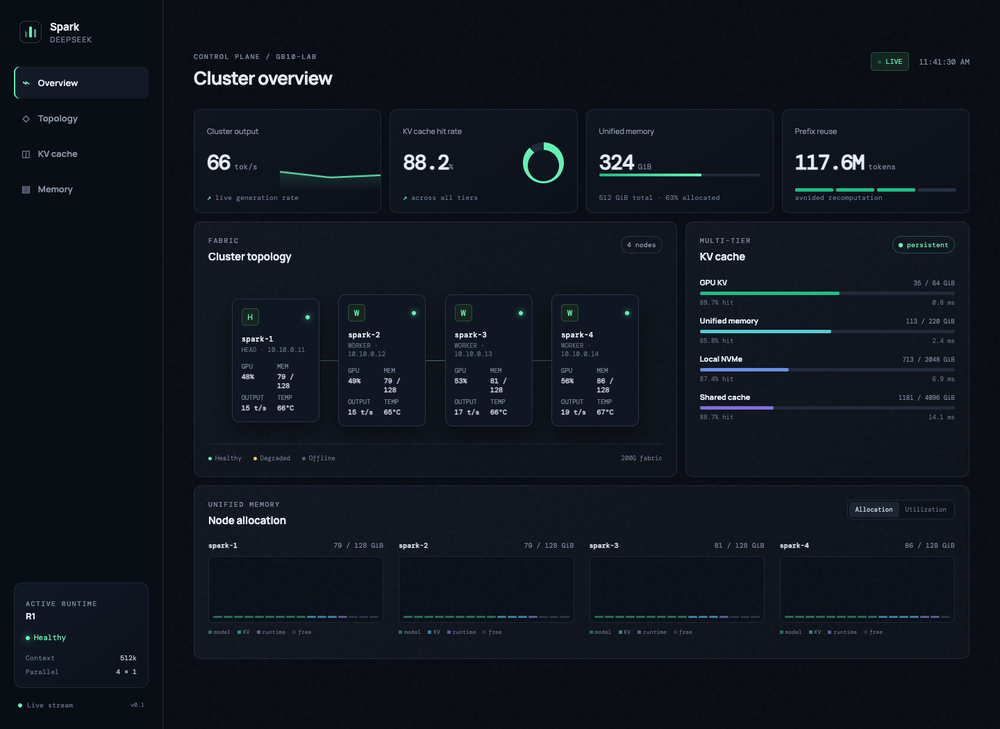
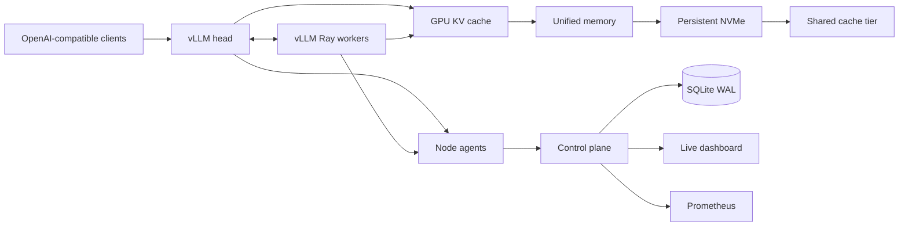

# Spark DeepSeek

Spark DeepSeek is an open control plane for running and observing DeepSeek inference across NVIDIA
GB10 systems. It combines distributed vLLM execution, multi-tier LMCache configuration, durable KV
cache storage, per-node telemetry, capacity planning, and a live cluster dashboard.



## What it provides

- **Distributed inference** — a Ray-backed vLLM runtime with tensor and pipeline parallel settings.
- **Long-context configuration** — first-class 128k, 256k, and 512k deployment profiles.
- **Restart-resilient KV cache** — GPU, unified memory, local NVMe, and shared-cache tiers through
  vLLM's LMCache connector. NVMe blocks live outside the inference pod lifecycle.
- **Cluster visibility** — live topology, health, throughput, temperature, allocation, and request load.
- **Cache visibility** — utilization, hit/miss ratios, latency, persistence state, and prefix reuse.
- **Open telemetry** — JSON APIs, WebSocket updates, Prometheus metrics, and a lightweight node agent.
- **Capacity planning** — estimate weight, runtime, and KV memory before changing a deployment.

The dashboard is responsive and has no frontend build step. The control plane stores a bounded history
in SQLite WAL mode and exposes the same snapshot used by the UI through `/api/v1/snapshot`.

## Quick start

```bash
docker compose up --build
```

Open [http://localhost:8080](http://localhost:8080). The compose profile starts with deterministic
cluster telemetry so the topology, memory, cache, history, WebSocket, and Prometheus paths are active.

For local development:

```bash
python3 -m venv .venv
source .venv/bin/activate
pip install -e '.[test,agent]'
spark-deepseek serve
```

## Architecture



The hot path stays inside vLLM and LMCache. The control plane receives telemetry and never proxies
inference payloads, so dashboard availability does not affect generation.

## Capacity plan

```bash
spark-deepseek plan --parameters 671 --bits 4 --context 524288 --concurrency 1
```

The result separates weights, KV cache, and runtime overhead. `kv_bytes_per_token_billions` is exposed
by the API because KV size varies with architecture, cache dtype, MLA implementation, and engine build.
For a deployment decision, feed the value measured from the selected model and runtime image.

## Kubernetes

Install the dashboard and node agents:

```bash
helm upgrade --install spark-deepseek deploy/helm/spark-deepseek \
  --namespace inference --create-namespace \
  --set image.repository=ghcr.io/thibautrey/spark-deepseek \
  --set image.tag=v0.1.0
```

To deploy the inference runtime too, provide a GB10-compatible image containing vLLM, Ray, LMCache,
and the model's quantization kernels, then enable the runtime:

```bash
helm upgrade --install spark-deepseek deploy/helm/spark-deepseek \
  --namespace inference --create-namespace \
  --set runtime.enabled=true \
  --set runtime.image.repository=REGISTRY/gb10-vllm-lmcache \
  --set runtime.image.tag=VERSION \
  --set runtime.tensorParallelSize=4
```

Each runtime pod requests one NVIDIA GPU and anti-affinity places the head and workers on distinct
hosts. The LMCache directory is mounted from each node at `/var/lib/spark-deepseek/lmcache`, preserving
cached blocks when an engine pod restarts. Set a dedicated storage path in production.

Set `runtime.cache.remoteUrl` to an LMCache-compatible remote backend when cache blocks should be
reused across nodes. `runtime.cache.remoteSerde` selects its serialization format; local NVMe remains
the durable node-level tier.

`MAX_MODEL_LEN=524288` reserves the serving envelope. The model weights and tokenizer configuration
must support the chosen context policy; context extension changes belong in the model configuration,
not in the dashboard.

## APIs and metrics

| Endpoint | Purpose |
| --- | --- |
| `GET /api/v1/snapshot` | Current cluster, runtime, cache, and memory state |
| `GET /api/v1/history?minutes=30` | Bounded snapshot history |
| `POST /api/v1/nodes` | Node-agent telemetry ingestion |
| `POST /api/v1/snapshot` | Full collector snapshot ingestion |
| `POST /api/v1/capacity` | Memory and node-count estimate |
| `WS /api/v1/stream` | Live dashboard updates |
| `GET /metrics` | Prometheus exposition |

Set `SPARK_DEEPSEEK_INGEST_TOKEN` on the server and every agent to authenticate writes. Read endpoints
can be placed behind an ingress authentication policy.

## Configuration

All control-plane settings use the `SPARK_DEEPSEEK_` prefix:

| Variable | Default | Description |
| --- | --- | --- |
| `MODE` | `demo` | `demo` produces live synthetic telemetry; `live` accepts collectors |
| `DATABASE_PATH` | `./spark-deepseek.db` | SQLite history database |
| `SAMPLE_INTERVAL_SECONDS` | `2` | Demo sample interval |
| `HISTORY_RETENTION_HOURS` | `24` | Stored history window |
| `INGEST_TOKEN` | unset | Bearer token required for telemetry writes |
| `CLUSTER_NAME` | `gb10-lab` | Dashboard cluster label |

## Development

```bash
make install
make lint
make test
make docker
```

The project is licensed under Apache 2.0.
