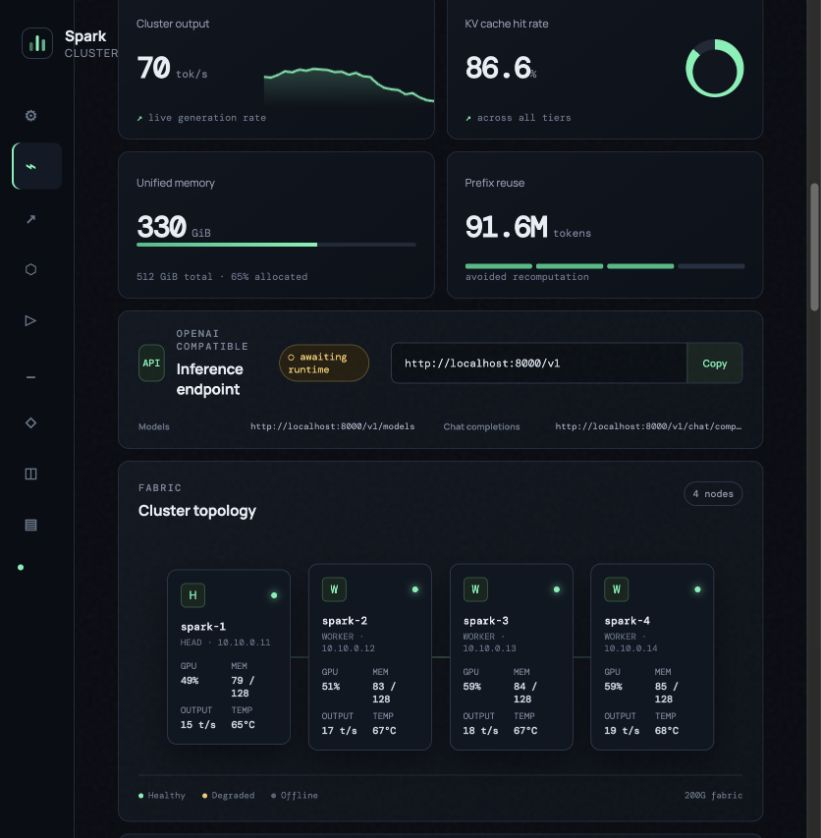
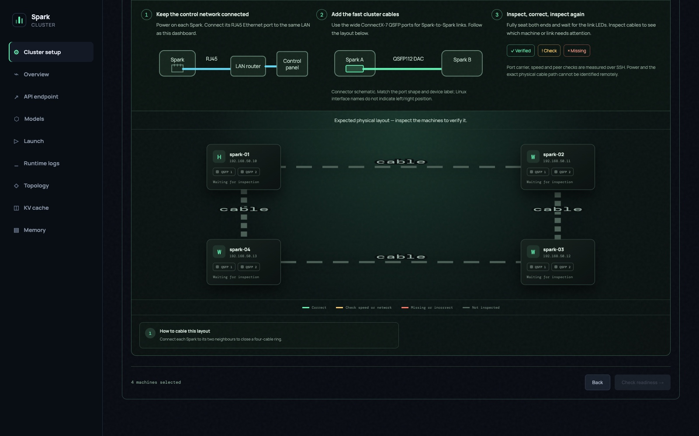
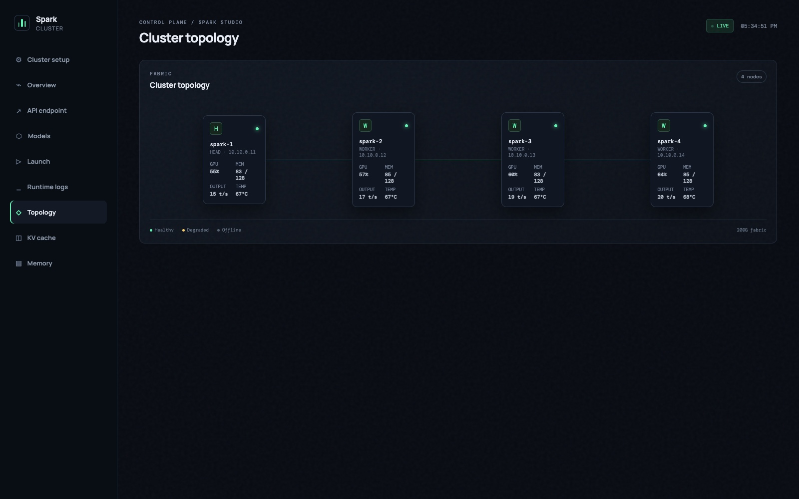
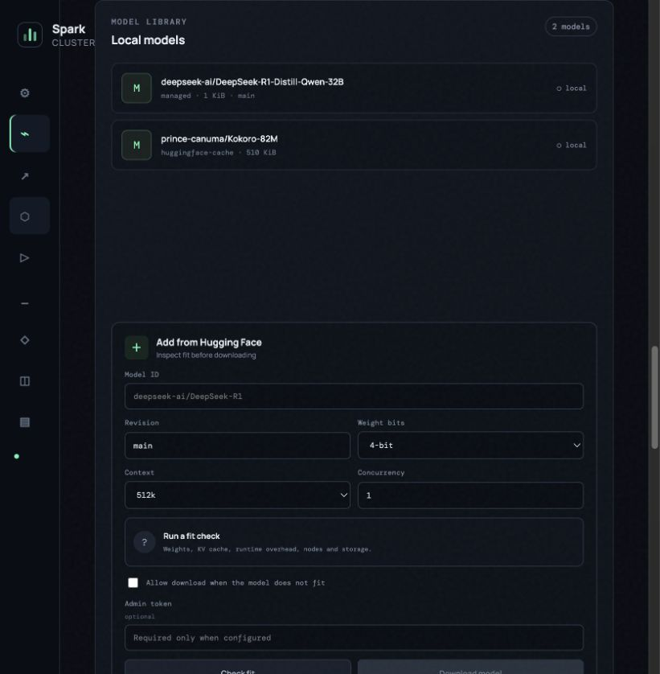
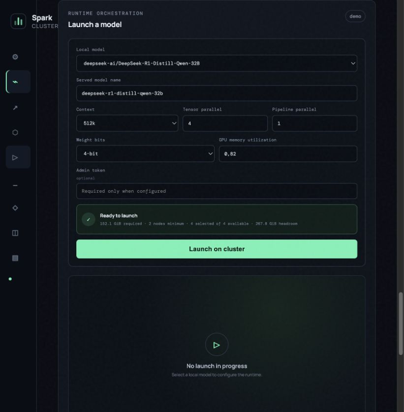
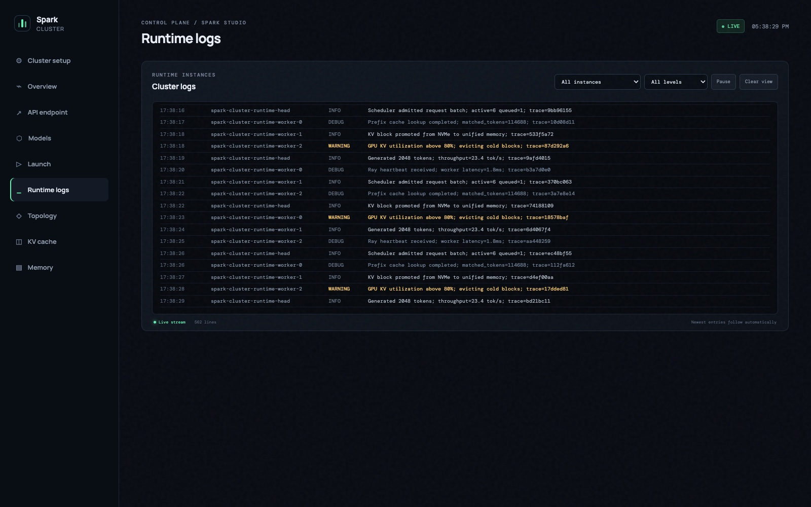
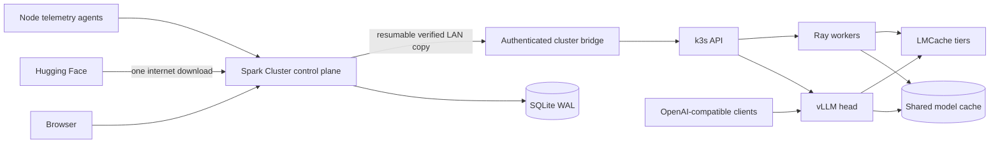

# Spark Cluster

The [runtime library](docs/runtime-library.md) lists ten inference runtimes with live
version discovery, controller-side image caching and verified imports onto managed
Linux machines. Open **Runtimes** in the dashboard to prepare a selected version.

<p align="center">
  <strong>A visual control plane for NVIDIA DGX Spark clusters.</strong><br>
  Discover machines, verify cabling, configure the cluster, launch models, and understand runtime health from one dashboard.
</p>

<p align="center">
  <a href="https://github.com/thibautrey/spark-cluster/actions/workflows/ci.yml"></a>
  <a href="LICENSE"></a>
  
  
</p>



Spark Cluster turns a set of DGX Spark systems into an approachable inference cluster. The dashboard can run on a NAS, VM, workstation, or one of the Sparks and control GPU machines on the same trusted LAN. Its guided setup covers physical preparation, network discovery, SSH verification, NVIDIA fabric checks, Kubernetes installation, model storage, observability, and runtime operations.

The runtime is model-agnostic and works with Hugging Face models supported by the selected vLLM image. DeepSeek models are fully supported, including architecture-aware MLA memory estimates.

## Why Spark Cluster

| Capability | What it changes for the operator |
| --- | --- |
| **Plug-and-play discovery** | Finds candidate machines with mDNS or a bounded private subnet scan and verifies SSH reachability. |
| **Visual hardware assistant** | Draws the required topology, distinguishes RJ45 management from QSFP fabric links, and highlights missing or uncertain cables. |
| **Remote control plane** | Runs away from the GPU nodes while an authenticated bridge performs cluster-local operations. |
| **Automated installation** | Installs pinned k3s components, NVIDIA scheduling, shared model storage, telemetry, and idle runtime resources. |
| **Actionable diagnostics** | Turns failed checks into a concrete remedy and lets interrupted setup resume from persisted state. |
| **Single internet download** | Downloads each model once on the controller, then relays verified files over the LAN into shared cluster storage. |
| **Model lifecycle** | Checks capacity before download, resumes internet and LAN transfers, lists cached models, and launches a selected model across the cluster. |
| **Operational visibility** | Shows topology, memory, throughput, KV-cache tiers, GPU state, endpoints, and per-runtime logs in real time. |
| **Open interfaces** | Exposes JSON APIs, WebSockets, Prometheus metrics, an OpenAI-compatible endpoint, Docker, and Helm deployment paths. |

## Product tour

<table>
  <tr>
    <td width="50%"><br><strong>Guided hardware preparation</strong><br>Follow illustrated RJ45 and QSFP steps, inspect negotiated links, and correct the highlighted machine or port.</td>
    <td width="50%"><br><strong>Cluster topology</strong><br>See node roles, fabric links, GPU activity, memory allocation, output rate, and temperature at a glance.</td>
  </tr>
  <tr>
    <td width="50%"><br><strong>Model library</strong><br>Inspect a Hugging Face repository, calculate fit, protect mutations with an admin token, and resume downloads.</td>
    <td width="50%"><br><strong>Cluster model launcher</strong><br>Choose context and parallelism, revalidate capacity, scale workers, and follow rollout readiness.</td>
  </tr>
  <tr>
    <td colspan="2"><br><strong>Runtime log console</strong><br>Stream and filter structured logs from the vLLM head and every Ray worker without leaving the dashboard.</td>
  </tr>
</table>

## How it works



The inference hot path stays between clients and vLLM. Dashboard availability does not proxy or gate generated tokens. Cluster commands remain in the bridge, and the external controller does not need Kubernetes credentials or direct access to model storage.

Guided setup installs the controller and runtime as separate Helm releases. Controller restarts and upgrades therefore cannot roll, scale, or delete inference pods. The controller rejects `/v1` requests with HTTP 421 to prevent accidental proxy use. See [controller-independent inference](docs/runtime-independence.md).

## Guided cluster setup

The setup flow is deliberately sequential:

1. **Discover** — find SSH machines on the management LAN or enter their addresses.
2. **Configure** — select head and worker roles and choose direct, four-node ring, or switched fabric topology.
3. **Prepare hardware** — follow connector diagrams, verify host fingerprints, and inspect ConnectX-7 links.
4. **Check readiness** — validate GB10, memory, storage, sudo, toolkit, clock, OS/driver parity, RDMA, peers, and fabric reachability.
5. **Install** — deploy pinned k3s, GPU scheduling, NFS model storage, the bridge, dashboard, and telemetry agents.
6. **Verify** — confirm GPU registration, workloads, storage, dashboard health, and a cross-node read/write check.

For direct links, a green result requires the expected point-to-point subnet, sufficient negotiated speed, successful interface-bound peer checks, and a neighbor MAC matching the remote fabric interface. Carrier alone stays amber. See the [cluster setup guide](docs/cluster-setup.md) for access, networking, supported layouts, recovery, and security boundaries.

### Measured optimization lab

The controller now turns runtime recommendations into executable, capability-checked launch plans.
It supports vLLM speculation and MoE controls, adaptive LMCache sizing, real runtime metrics,
repeatable streaming benchmarks, and privacy-preserving prefix prewarming. TensorFold and DeepInfer
stay blocked until their GB10 command and kernel contracts are validated. See the
[optimization lab guide](docs/optimization-lab.md) for the exact capabilities and measurement gates.

### Performance-aware setup and launch

The topology assistant follows NVIDIA's current multi-Spark results. A four-node switchless ring is a
supported tensor-parallel layout; a 200G switch remains the faster and more flexible choice for
low-concurrency decode, any-to-any traffic, and independent model pools. NVIDIA measured Qwen3.8-27B
NVFP4 at 32.82 decode tok/s on a four-Spark physical ring and 36.34 tok/s on a switched cluster with
RoCEnante at concurrency one. The launch screen explains this tradeoff instead of requiring a switch.

Selecting a local model now builds an automatic performance plan from its family, the available node
count, context, and intended workload. The controller bounds vLLM scheduler concurrency and batched
tokens, chooses FP8 KV for validated long-context profiles, keeps CUDA graphs enabled, and forces NCCL
onto RoCEv2 without pinning the reboot-volatile GID index. DeepSeek V4.1 Flash and GLM 5.3 Flash plans
also show their specialized engine, weight-layout, speculative-decoding, license, and storage guidance.
These recommendations cite the [official NVIDIA scaling results](https://developer.nvidia.com/blog/running-frontier-class-ai-models-across-8-nvidia-dgx-spark-nodes/),
the [measured DeepSeek V4.1 Spark recipes](https://github.com/tonyd2wild/DeepSeek-V4.1-Flash-vLLM-DGX-Spark),
and the [GLM 5.3 Flash optimization campaign](https://github.com/chishiki37/glm-5.3-flash-nvfp4-dgx-spark).

The download fit check treats storage, physical placement, and launcher support as separate gates.
It uses the repository's detected quantization and actual weight files instead of pretending the
precision selector converts a checkpoint. It evaluates per-rank weight, KV, and runtime overhead,
then reports one of these placements:

- **Full memory:** weights and active KV fit on every selected rank after tensor sharding.
- **Engram on local NVMe:** DeepSeek V4.1 keeps dense and expert weights resident while sparse Engram
  rows stay on each Spark's SSD. Quantized packs also account for the two required base-model Engram
  shards that are not present in the selected repository.
- **Tiered KV:** LMCache stores cold prefixes for reuse. The planner never assumes that prefix
  caching removes active decode KV; it recommends reducing context/concurrency or validating an
  active-offload engine before claiming a runtime fit.
- **MoE expert offload:** recognized as an engine-specific option. The planner does not claim that
  sparse activation alone reduces resident weights, and it requires a measured compatible engine.
- **GGUF mmap or another runtime:** downloads are permitted when storage fits, while the dashboard
  identifies the required engine and warns when SSD paging can substantially reduce decode speed.

A repository can therefore be downloaded even when no validated runtime placement currently fits.
Insufficient repository storage remains a hard block. Launching stays stricter: it requires a
capacity fit, sufficient artifact storage, and a supported engine. Hybrid Engram plans show local
NVMe requirements and remain gated on specialized engine integration. Estimates are not throughput
guarantees; CPU and GPU memory on DGX Spark share the same physical RAM.

## Run the dashboard

### Docker Compose

```bash
docker compose up --build
```

Open [http://localhost:8080](http://localhost:8080). The default demo mode provides deterministic telemetry and safe simulated setup screens.

### Python

```bash
python3 -m venv .venv
source .venv/bin/activate
pip install -e '.[test,agent]'
spark-cluster serve --host 0.0.0.0 --port 8080
```

### External controller on a LAN host

```bash
export SPARK_CLUSTER_MODE=live
export SPARK_CLUSTER_SETUP_ENABLED=true
export SPARK_CLUSTER_SETUP_SSH_IDENTITY=/absolute/path/to/id_ed25519
export SPARK_CLUSTER_MODEL_ADMIN_TOKEN='set-with-your-secret-manager'
spark-cluster serve --host 0.0.0.0 --port 8080
```

Keep the dashboard on a trusted management network. Verify every displayed SSH host fingerprint on the corresponding device before authorizing setup.

### Multiple clusters and local Docker GPUs

The controller keeps a persistent cluster registry. A target can be an authenticated remote bridge (including a DGX Spark cluster) or a local NVIDIA Docker host. Selecting a cluster changes capacity checks, model delivery, launches, logs, telemetry and the direct inference endpoint together. Downloads record their target cluster, and a controller copy can be delivered to another remote cluster without downloading the model from Hugging Face again.

To let a controller container manage GPUs on its own Docker host, mount the Docker socket and the same host model directory used by runtime containers, expose the assigned NVIDIA devices, and keep the administration token enabled:

```bash
docker run --gpus all --group-add "$(stat -c %g /var/run/docker.sock)" \
  -v /var/run/docker.sock:/var/run/docker.sock \
  -v /host/models:/models \
  -e SPARK_CLUSTER_DOCKER_RUNTIME_ENABLED=true \
  -e SPARK_CLUSTER_DOCKER_HOST_MODEL_PATH=/host/models \
  -e SPARK_CLUSTER_DOCKER_RUNTIME_HOST=192.168.1.10 \
  -e SPARK_CLUSTER_RUNTIME_VLLM_IMAGE=vllm/vllm-openai:latest \
  -e SPARK_CLUSTER_MODEL_ADMIN_TOKEN=... \
  spark-cluster:latest serve --host 192.168.1.10 --port 8769
```

Docker socket access grants host-level container control. Keep the controller on a trusted LAN, restrict its administration token, and do not expose `/var/run/docker.sock` to unrelated applications. Spark Cluster creates one labeled vLLM container per local cluster, limits it to the cluster's assigned GPU indices, mounts models read-only, and leaves the inference container running independently of controller updates.

NVFP4 is Blackwell-specific. On older NVIDIA GPUs, Spark Cluster allows storage of an NVFP4 repository but blocks launch and explains which compatible quantization family to choose.

## Model compatibility

Spark Cluster manages repositories and runtime settings without hard-coding a model family. Compatibility depends on the vLLM runtime image, quantization kernels, model architecture and compute capability of the selected target GPUs.

Common use cases include:

- DeepSeek R1 and DeepSeek V3 derivatives, with MLA-aware capacity metadata when available;
- Qwen, Llama, Mistral, and other Hugging Face causal language models supported by vLLM;
- BF16/FP16, 8-bit, and 4-bit capacity planning;
- 128k, 256k, and 512k serving profiles;
- tensor and pipeline parallel layouts across local GPUs or remote nodes.

Always run **Check fit** before downloading or launching. It separates weights, KV cache, runtime overhead, storage, usable unified memory, required node count, and remaining headroom. The catalog can also be filtered by accelerator count at a selected context length. Cards show full-memory, hybrid, and specialized-engine fits before a repository is selected.

## Model library and launch flow

Downloads use Hugging Face's resumable snapshot cache on the external controller. After the internet download completes, Spark Cluster creates a signed manifest with the size and SHA-256 digest of every model file. The bridge resumes file-by-file HTTP transfers from the controller, verifies every digest, and installs the result into the cluster's shared model volume. GPU nodes mount that volume instead of contacting Hugging Face individually.

Jobs, attempts, internet progress, LAN delivery progress, fit results, and errors are persisted in SQLite on both sides. Interrupted internet downloads and partial LAN files are reused after a restart. Downloads can be paused without losing partial files, resumed from their previous position, or cancelled with partial-file cleanup on both the controller and cluster. Deleting a managed model removes the controller copy and the shared cluster copy after confirmation. If cluster delivery fails, the complete controller copy remains available and **Retry** restarts only the LAN stage.

A launch performs these steps:

1. validates that the selected managed model still fits the current cluster;
2. checks the pinned runtime image and installed version on every SSH-managed node;
3. offers one-click installation or update when a node is missing the required runtime;
4. scales the Ray worker StatefulSet for the requested parallelism;
5. applies model path, served name, context, quantization, and memory target;
6. recreates the vLLM head so the previous process releases its GPU;
7. waits for workers and the vLLM readiness endpoint;
8. persists progress and exposes retryable failures in the dashboard.

The readiness sheet keeps the default workflow visual and concise. Its optional power-user view shows installation logs for every node and opens a real interactive SSH terminal through a single-use, 60-second WebSocket ticket. Terminal access is restricted to the nodes and pinned host keys saved by the setup wizard.

## OpenAI-compatible endpoint

The endpoint card displays the exact URL once a runtime is ready:

```bash
export OPENAI_BASE_URL=http://spark-head.local:30000/v1
export OPENAI_API_KEY=unused
curl "$OPENAI_BASE_URL/models"
```

Set `SPARK_CLUSTER_OPENAI_API_KEY` when the runtime requires bearer authentication. The key is used server-side for readiness and model discovery and is never returned by the API.

## Kubernetes and Helm

```bash
helm upgrade --install spark-cluster deploy/helm/spark-cluster \
  --namespace inference \
  --create-namespace \
  --set image.repository=ghcr.io/thibautrey/spark-cluster \
  --set image.tag=v0.1.0
```

Enable the runtime with a GB10-compatible image containing vLLM, Ray, LMCache, and the quantization kernels required by the selected model:

```bash
helm upgrade --install spark-cluster deploy/helm/spark-cluster \
  --namespace inference \
  --create-namespace \
  --set runtime.enabled=true \
  --set runtime.image.repository=REGISTRY/gb10-vllm-lmcache \
  --set runtime.image.tag=VERSION \
  --set runtime.tensorParallelSize=4
```

The chart uses anti-affinity to place the head and workers on distinct nodes, a shared RWX model volume, per-node persistent LMCache paths, and namespace-scoped RBAC. Runtime resources stay idle until a model is launched.

## Configuration

All settings use the `SPARK_CLUSTER_` prefix.

| Setting | Default | Purpose |
| --- | --- | --- |
| `MODE` | `demo` | `demo` for deterministic UI data or `live` for collectors and remote control. |
| `DATABASE_PATH` | `./spark-cluster.db` | SQLite state, bounded history, downloads, launches, logs, and setup jobs. |
| `CATALOG_CACHE_PATH` | next to `DATABASE_PATH` | Separate bounded SQLite cache for Hugging Face metadata and per-context capacity plans. |
| `MODEL_CACHE_PATH` | `./models` | Managed Hugging Face model cache. |
| `MODEL_ADMIN_TOKEN` | unset | Protects setup, download, retry, and launch mutations. |
| `INGEST_TOKEN` | unset | Authenticates node telemetry writes. |
| `OPENAI_API_BASE` | `http://localhost:8000/v1` | Runtime endpoint exposed to clients. |
| `OPENAI_API_KEY` | unset | Optional server-side runtime bearer token. |
| `SETUP_ENABLED` | `false` | Enables discovery and SSH-based provisioning. |
| `SETUP_SSH_IDENTITY` | unset | Existing private key used for verified bootstrap access. |
| `SETUP_IMAGE_REPOSITORY` | `ghcr.io/thibautrey/spark-cluster` | Image installed on cluster nodes. |
| `SETUP_IMAGE_DIGEST` | unset | Immutable image digest used instead of a mutable tag. |
| `REMOTE_CLUSTER_URL` | unset | Authenticated cluster bridge attached to an external controller. |
| `CONTROLLER_PUBLIC_URL` | request LAN URL | Controller URL the cluster uses to fetch staged files. Set it when the browser-facing URL is not reachable from the cluster. |
| `DOCKER_RUNTIME_ENABLED` | `false` | Enables runtime lifecycle through a mounted Docker Engine socket. |
| `DOCKER_SOCKET_PATH` | `/var/run/docker.sock` | Docker Engine Unix socket inside the controller. |
| `DOCKER_HOST_MODEL_PATH` | `/models` | Host-side model directory bind-mounted read-only into local runtime containers. |
| `DOCKER_RUNTIME_HOST` | `127.0.0.1` | LAN address clients use for the local runtime API. |
| `DOCKER_RUNTIME_PORT_START` | `30000` | First host-network port reserved for local cluster runtimes. |

The complete setup-specific reference is in [docs/cluster-setup.md](docs/cluster-setup.md).

## APIs and observability

| Interface | Purpose |
| --- | --- |
| `GET /api/v1/snapshot` | Current cluster, runtime, cache, memory, and node state. |
| `GET /api/v1/history` | Bounded telemetry history. |
| `POST /api/v1/capacity` | Model memory and node-count estimate. |
| `GET /api/v1/models` | Managed, cached, and runtime-reported models. |
| `POST /api/v1/models/fit` | Repository metadata and fit preflight. |
| `GET /api/v1/models/storage` | Available bytes in the cluster's shared model volume. |
| `POST /api/v1/performance/plan` | Model, workload, node, and topology-aware launch settings. |
| `POST /api/v1/models/download` | Resumable model download. |
| `POST /api/v1/downloads/{id}/pause` | Suspend an internet or LAN transfer and preserve partial files. |
| `POST /api/v1/downloads/{id}/resume` | Continue a paused transfer from preserved files. |
| `POST /api/v1/downloads/{id}/cancel` | Stop a transfer and remove partial controller and cluster files. |
| `DELETE /api/v1/model-management/models/{repo}` | Delete a managed model from controller and cluster storage. |
| `POST /api/v1/models/import` | Ask the bridge to copy a staged controller model into shared storage. |
| `GET /api/v1/controller/downloads/{id}/manifest` | Signed file manifest used by the cluster bridge. |
| `GET /api/v1/controller/downloads/{id}/files/{path}` | Range-capable authenticated LAN file delivery. |
| `GET /api/v1/logs` | Persisted, filterable runtime logs. |
| `WS /api/v1/logs/stream` | Live runtime log stream. |
| `POST /api/v1/launches` | Validate and launch a managed model. |
| `POST /api/v1/runtime-management/readiness` | Inspect required runtime versions across managed nodes. |
| `POST /api/v1/runtime-management/install` | Install or update the pinned runtime image on every node. |
| `GET /api/v1/runtime-management/install/{id}` | Read per-node installation state and logs. |
| `POST /api/v1/runtime-management/terminal-ticket` | Issue a short-lived ticket for a trusted-node WebTTY. |
| `POST /api/v1/setup/discover` | Bounded LAN discovery. |
| `POST /api/v1/setup/hardware` | Read-only fabric and cable inspection. |
| `POST /api/v1/setup/jobs` | Persisted cluster installation workflow. |
| `WS /api/v1/stream` | Live dashboard updates. |
| `GET /metrics` | Prometheus exposition. |

## Security model

- SSH host keys are pinned before any remote command runs.
- The browser never submits passwords or private keys.
- Setup state and structured logs exclude command output that may contain secrets.
- External bridge requests use timestamped HMAC signatures with replay protection.
- Kubernetes RBAC is scoped to telemetry, pod logs, and the named runtime resources.
- Image digests can be pinned for every installed workload.
- Discovery accepts only private IPv4 targets and limits subnet scans to `/24`.

Read [SECURITY.md](SECURITY.md) before exposing the service beyond a trusted LAN.

## Development

```bash
pip install -e '.[test,agent]'
ruff check .
ruff format --check .
pytest
helm lint deploy/helm/spark-cluster
```

The frontend is dependency-free HTML, CSS, and JavaScript served by FastAPI. No frontend build step is required.

## License

Apache License 2.0. See [LICENSE](LICENSE).

## Browse models from the controller

Discover models directly in Spark Cluster with a native Hugging Face browser inspired by
[HFDesk](https://github.com/bashrusakh/hfdesk). Search by model or author, browse trending,
most downloaded, most liked, or recently updated repositories, and filter by task, format,
and access requirements. Select a model to inspect its architecture, license, parameter count,
repository size, and file list before downloading.

Check capacity with your chosen context, concurrency, and weight precision, then download once
on the controller and distribute over the LAN using the existing resumable delivery pipeline.
Cards show download and local availability states. Repository-ID entry remains available as an
advanced fallback. Discovery runs on the controller even before a cluster is connected.

Downloads include the **entire repository**, including alternative weight files. Weight bits in
the capacity planner estimate memory; they do not convert or quantize downloaded weights.
Available formats and tasks in the catalog do not guarantee compatibility with the configured
vLLM runtime. Review the model card and license before running a model. For gated repositories,
accept access on Hugging Face and configure `SPARK_CLUSTER_HF_TOKEN` on the controller; the
credential is never sent to the browser. Catalog requests have bounded page sizes and request timeouts. Hugging Face responses and capacity results are stored in a separate bounded SQLite WAL database. Cache keys include the repository commit, Spark count, context, KV precision, memory assumptions, and planner version, so repeated filters avoid network and fit recomputation without reusing stale model revisions.

### Evidence-based model discovery

The catalog combines technical metadata, exact-revision community recipes and bounded popularity signals. Every recommendation explains its evidence and caveats; capacity and runtime launch support remain separate checks. See the [research and deterministic ranking policy](docs/research/model-selection-2026-10-23.md).

## MCP server for AI clients

The controller exposes a stateless [Model Context Protocol](https://modelcontextprotocol.io/) Streamable HTTP endpoint:

```text
http://sparkcluster.lan/mcp
```

Point any Streamable HTTP MCP client at that URL. Read-only tools require no credential:

| Tool | Purpose |
| --- | --- |
| `search_model_catalog` | Search the live Hugging Face shortlist with the evidence-based Spark ranking or an explicit Hub sort. |
| `inspect_model` | Read exact repository metadata, recommendation evidence, license, files and README. Repository content is returned with an explicit untrusted-content notice. |
| `check_model_fit` | Compare memory, storage, runtime and placement feasibility for up to 12 models on 1–16 Sparks. |
| `get_cluster_status` | Read the latest cluster, node, memory, cache and runtime snapshot. |
| `list_installed_models` | Inspect models available to the controller or cluster runtime. |
| `list_model_activity` | Follow download and launch jobs. |

The `recommend-models` MCP prompt guides a client through search, repository inspection and capacity checks rather than treating downloads, names or README claims as proof.

When `SPARK_CLUSTER_MODEL_ADMIN_TOKEN` is configured, clients that send the same token as an `Authorization: Bearer …` header additionally receive `download_model` and `launch_model`. Keep that credential in the MCP client's secret store. A client without the header remains read-only. If the controller has no administration token configured, its existing unprotected mutation policy also applies to MCP.

Generic client configuration:

```json
{
  "mcpServers": {
    "spark-cluster": {
      "type": "streamable-http",
      "url": "http://sparkcluster.lan/mcp"
    }
  }
}
```

For administrative access, configure an `Authorization` header through the client's secret mechanism. Do not commit the token to a repository or client configuration file.

### Hugging Face account for downloads

While a Hub download is queued or running without a configured token, the model
library offers a password field to save a Hugging Face read token. The controller
validates it with Hugging Face and stores it in its persistent setup-state volume
with owner-only permissions. Saving requires the controller administration token
when authentication is enabled. Credentials are never returned by the API.

Active Hub workers restart with the new credentials and reuse their partial files;
queued downloads use the token when they start, paused downloads remain paused,
and LAN distribution is unaffected. The form disappears after a successful save.

Authentication provides account-based request quotas and may reduce throttling.
It does not guarantee higher transfer throughput: bandwidth, Hub/CDN conditions,
Xet reconstruction and destination storage still matter. See the
[Hugging Face rate-limit reference](https://huggingface.co/docs/hub/rate-limits).
